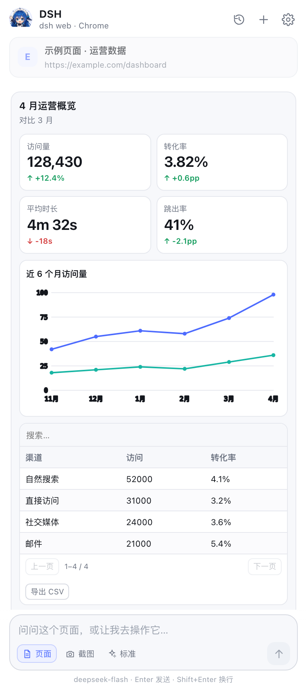
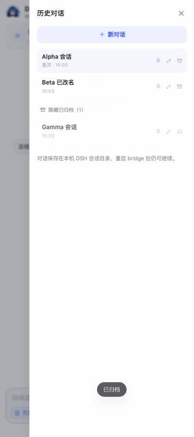

# DSH EasySider

A Chrome side panel that puts a [DeepSeek Harness](https://github.com/deepseek-ai/deepseek-harness) agent beside the page you are reading. It understands the current tab, answers questions from the page, and can actually operate the browser: click, type, scroll, navigate, find text, highlight, and take screenshots.

Rich answers render as native cards, tables, charts, timelines and forms through [`deepseek-harness-intelligent-ui`](https://github.com/dreamfarer-space/deepseek-harness-intelligent-ui) instead of a wall of Markdown.

[简体中文](README.md) · **English**


> **Status:** experimental community project. It is not an official DeepSeek product and is not affiliated with or endorsed by DeepSeek.

---

## Highlights

- **Page-aware chat** — title, URL, readable text, heading outline and the current selection are attached to your message (optional).
- **Browser control** — read the page, snapshot interactive elements with stable `e1…eN` refs, click, type, scroll, find, navigate, highlight, wait and screenshot.
- **Intelligent UI** — the agent can answer with live components (`ui_render`, `ui_compose`, `ui_patch`), and the side panel renders them natively. Edits patch the same card in place.
- **Reasoning effort** — switch between auto / fast / standard / deep / maximum between turns.
- **Session history** — pin, rename, archive and restore conversations.
- **Local by default** — the bridge listens on `127.0.0.1` only and shares the `dsh web` environment (`~/.dsh`), so credentials and the model are the ones you already use.
- **Narrow tool surface** — the side-panel agent has browser tools and web read/search, but **no shell, file system, subagents or workflow tools**.

---

## How it works

```
┌──────────────────────── Chrome ────────────────────────┐
│  side panel (HTML/JS)          content script           │
│  · chat UI + rich UI renderer  · read page / snapshot   │
│  · executes browser tools      · click / type / wait    │
│         │  chrome.tabs / chrome.scripting               │
└─────────┼───────────────────────────────────────────────┘
          │  HTTP + SSE on 127.0.0.1:8787 (bearer token)
┌─────────▼───────────────────────────────────────────────┐
│  server/bridge.mjs                                      │
│  · owns the DSH child process and streams its events     │
│  · routes MCP tool calls to the side panel               │
└─────────┬───────────────────────────────────────────────┘
          │  stdio JSON-RPC
┌─────────▼───────────────────────────────────────────────┐
│  dsh --profile sdk   (DSH_HOME=~/.dsh by default)       │
│  · model, sessions, compaction, credentials              │
│  · browser tools via MCP (server/browser-mcp.mjs)        │
│  · intelligent-ui plugin (optional, recommended)         │
└─────────┬───────────────────────────────────────────────┘
          │  MCP stdio
┌─────────▼───────────────────────────────────────────────┐
│  server/browser-mcp.mjs                                 │
│  forwards each browser_* call back to the bridge         │
└─────────────────────────────────────────────────────────┘
```

### Why `sdk` and not the `web` profile?

`dsh web` is an HTTP application (web server + browser frontend) and does not expose a chat stream to external clients. The bridge needs a long-lived stdio agent, so it uses DSH's `sdk` composition while pointing `DSH_HOME` at the `dsh web` environment. The agent core, model, credentials and session store are the same; only the transport differs. The side panel has its own UI renderer for the intelligent-ui component tree.

If you want the `dsh web` GUI agent to control Chrome too, you can mount the same MCP server into the `web` profile — see [`examples/web-profile-browser.patch.yml`](examples/web-profile-browser.patch.yml).

---

## Requirements

| Requirement | Notes |
|---|---|
| Node.js ≥ 22.19 | DSH runtime requirement |
| Chrome / Chromium ≥ 116 | Side Panel API |
| `dsh` on `PATH` | DeepSeek Harness CLI |
| `dsh web` used at least once | Creates `~/.dsh` with your credentials and model choice |
| Optional: `deepseek-harness-intelligent-ui` | Enables `ui_render` / `ui_compose` / `ui_patch`; without it you still get Markdown |
| macOS only for icon regeneration | `tools/make-icons.mjs` uses `sips` |

The bridge has **no runtime npm dependencies**. You only need `npm install` for the browser tests (`playwright-core`).

---

## Quick start

### 1. Clone

```sh
git clone https://github.com/Uhao86/dsh-easysider.git
cd dsh-easysider
```

### 2. Install the intelligent UI plugin (recommended, once)

```sh
DSH_HOME=~/.dsh dsh plugin --profile sdk add deepseek-harness-intelligent-ui@0.2.13
```

Pass `DSH_HOME` explicitly: the bridge deliberately ignores an ambient `DSH_HOME` (it may point at another harness), and the plugin must be installed into the profile the bridge actually uses.

### 3. Start the bridge

```sh
./start
```

You should see:

```
  DSH EasySider bridge
  ├─ api      http://127.0.0.1:8787/api/health
  ├─ token    <random token>
  ├─ pairing  http://127.0.0.1:8787/
  └─ agent    dsh --profile sdk  (deepseek-official/deepseek-flash)
      DSH_HOME ~/.dsh  (shared with dsh web)
```

Stop it with `./stop`, or `Ctrl-C` in the terminal. On Windows, run `node server/bridge.mjs` instead.

### 4. Load the extension

1. Open `chrome://extensions`
2. Turn on **Developer mode**
3. Click **Load unpacked** and select this repository's `extension/` directory
4. Pin the toolbar icon

The extension is **not on the Chrome Web Store**; loading it unpacked is the supported way to run it. Chrome will warn about reading and changing data on all sites and about the debugger permission — both are required for page control and full-page screenshots (see [Permissions](#privacy-security-and-permissions)).

### 5. Pair

Click the toolbar icon (or `Alt+Shift+S`). The first run shows an onboarding card:

- Click **自动获取 Token** (Get token automatically); the panel asks `127.0.0.1:8787/api/pair`
- Or open `http://127.0.0.1:8787/`, copy the token, and paste it into Settings
- If the bridge uses another port, change **Bridge 地址** first

### 6. Try it

Open any page and ask:

- `Summarize this page in three bullets.`
- `Explain the selected paragraph.`
- `Find the sign-in link and open it.`
- `What fields does this form have?`
- `Use ui_render to make a dashboard of the numbers on this page.`

The assistant answers in the language you use. When it needs the DOM it calls a browser tool; the tool row shows what happened.

---

## Browser tools

The model sees `mcp__browser__browser_*`; the UI shows short Chinese labels.

| Tool | What it does |
|---|---|
| `browser_status` | List tabs and identify the active one |
| `browser_read` | Title, URL, selection, heading outline and main text |
| `browser_snapshot` | Interactive elements with stable refs (`e1…eN`) |
| `browser_open` | Navigate the active tab or a new tab, then wait for load |
| `browser_click` | Click by ref, CSS selector or visible text |
| `browser_type` | Type into an input, optionally submit |
| `browser_scroll` | Up/down/top/bottom, or scroll an element into view |
| `browser_find` | Find visible text and return snippets plus refs |
| `browser_screenshot` | Visible area (default) or full page via CDP |
| `browser_history` | Back, forward, reload |
| `browser_highlight` | Draw a box around refs or a text match |
| `browser_wait` | Wait for a selector, text, or a fixed delay |

`web_search` and `web_fetch` come from DSH itself.

Refs are stable for the lifetime of a page but become stale after navigation or a large DOM update; the agent is instructed to take a fresh snapshot on failure.

---

## Intelligent UI

When the `intelligent-ui` plugin is installed, the side panel renders these DSH tools natively:

| Tool | Purpose |
|---|---|
| `ui_render` | Declarative component tree |
| `ui_compose` | Markdown prose interleaved with component blocks |
| `ui_patch` | Update a previously rendered card in place (works across messages) |

Supported components include Card, Stack, Grid, Tabs, Text, Code, Alert, Badge, Divider, Stat, Progress, List, Table (sort/search/page/CSV), Chart (bar/line/area/pie), Scatter, Heatmap, Timeline, CodeDiff, FileTree, JsonView, Image, Gallery, Video, Choice, Button and Form.

<p align="center"></p>

<p align="center"><em>Rich UI rendered natively: KPI tiles, a line chart and a sortable table. <code>ui_patch</code> updates the card in place.</em></p>

Known gaps:

- `ui_render_widget` (3D / custom HTML) is **disabled** by the generated profile patch: MV3's extension CSP blocks arbitrary inline and remote scripts. Use the full `dsh web` app for widgets.
- `Math` (KaTeX), `Mermaid`, `Map` and `Plot` currently show a source/list fallback.
- Table sorting, tab selection and form state reset when the whole message is re-rendered.

---

## Reasoning effort

Use the **思考** selector next to the composer. The options are Chinese in the current UI:

| UI label | `reasoningEffort` |
|---|---|
| 自动 (Auto) | omitted (model default) |
| 快速 (Fast) | `off` |
| 标准 (Standard) | `low` |
| 深入 (Deep) | `high` |
| 极限 (Maximum) | `max` |

Changing it while idle calls `POST /api/settings`, persists the choice, and restarts the DSH runtime so the next message uses the new effort. While a turn is running the request is refused (HTTP 409) to avoid killing it mid-flight.

---

## Session history

The **历史对话** sheet supports (the icons are 置顶 / 重命名 / 归档):

- **Pin** — pinned conversations sort above recent ones.
- **Rename** — inline edit; Enter saves, Esc cancels. Custom titles are never overwritten by the first message.
- **Archive / restore** — archived conversations fold into “Show archived”.

<p align="center"></p>

<p align="center"><em>The history sheet: pin, rename and archive.</em></p>

The title index lives in `.runtime/sessions.json`; full session logs live under `DSH_HOME/sessions/`. For development cleanup:

```sh
node tools/clean-test-sessions.mjs          # dry run
node tools/clean-test-sessions.mjs --apply  # remove probe/smoke/test sessions
```

The cleanup only removes `sidebar-probe-*`, `sidebar-smoke-*`, `sidebar-test-*`, `sidebar-sessions-*` and sessions under test-only home directories. Real `sidebar-<uuid>` conversations are kept.

---

## Configuration

The bridge accepts flags or environment variables and persists port, token, model and effort in `.runtime/config.json` (mode 600). `DSH_HOME` is resolved at every launch and is not persisted.

| Flag | Environment | Default |
|---|---|---|
| `--port` | `DSH_SIDEBAR_PORT` | `8787` |
| `--model` | `DSH_SIDEBAR_MODEL` | `deepseek-flash` |
| `--provider` | `DSH_SIDEBAR_PROVIDER` | `deepseek-official` |
| `--dsh-home` | `DSH_SIDEBAR_DSH_HOME` | `~/.dsh` |
| `--max-page-chars` | `DSH_SIDEBAR_MAX_PAGE_CHARS` | `8000` |
| `--reasoning-effort` | `DSH_SIDEBAR_EFFORT` | `auto` |
| runtime directory | `DSH_SIDEBAR_RUNTIME` | `.runtime` |
| `dsh` binary | `DSH_BIN` | auto-detected |

In the side-panel **设置** you can change the bridge URL and token, and toggle **页面** (attach page text) and **截图** (attach the visible area).

Session ids look like `sidebar-<uuid>`. UI message caches live in `chrome.storage.local`; full events live in `DSH_HOME/sessions/`.

---

## Privacy, security and permissions

**Local bridge.** The bridge binds `127.0.0.1` only. Every API call needs the random token; the pairing endpoint accepts extension/local origins. Delete `.runtime/config.json` to rotate the token.

**What leaves your machine.** Page text, the selected text, and screenshots you attach are sent to the model provider configured in DSH (`deepseek-official` by default) as part of the prompt. DSH's own data-handling terms apply. This project adds no telemetry, analytics or cloud service.

**Local data.** The token is stored in `.runtime/config.json` (0600) and `chrome.storage.local`; conversations are stored in `~/.dsh/sessions/` and the UI cache in `chrome.storage.local`.

**Permissions.**

| Permission | Why |
|---|---|
| `sidePanel` | The UI itself |
| `tabs` | Read tab title/URL, list tabs, navigate |
| `scripting` + `<all_urls>` | Inject the content script into the page you ask about |
| `activeTab` | User-invoked access to the current tab |
| `storage` | Settings and local message cache |
| `contextMenus` | “Summarize this page / explain selection” |
| `debugger` | Full-page screenshot via Chrome DevTools Protocol |

You can narrow `<all_urls>` to specific sites if you only use the panel there; `ensureInjected` will then fail gracefully elsewhere.

**Prompt injection.** Page content is untrusted input. The agent is instructed to ignore page text that tries to change its task, exfiltrate secrets or trigger unrelated navigation. This is a mitigation, not a hard sandbox.

**Real side effects.** Clicking and typing affect the same session you use in Chrome, including logged-in sites. Do not let the agent operate payment, password-manager or browser-settings pages unattended.

**No local execution.** The generated `sdk` overlay disables `bash`, PowerShell, file read/write, subagents, workflows, goals and plan mode. The agent can read pages, call browser tools and use web search/fetch.

---

## Limitations

- Main frame only; cross-origin iframes and much of shadow DOM are out of reach.
- Refs go stale after navigation or large DOM changes.
- Streaming arrives per committed step, not token by token.
- Stop kills the DSH runtime; the session is persisted and the next message attempts `session/resume`.
- `chrome://`, the Web Store and the PDF viewer cannot be scripted.
- Full-page screenshots use `chrome.debugger` and show Chrome's debugging banner briefly.
- The side panel shares `~/.dsh` with `dsh web`; sidebar conversations appear in the same session directory unless you pass `--dsh-home`.
- The side-panel chrome (buttons, labels) is Chinese-only for now; the assistant answers in your language.
- Experimental; APIs and the component renderer may change.

---

## Development

```sh
npm install                 # playwright-core, only for tests
node --check server/bridge.mjs

node test/render.mjs        # rich UI renderer + compose, no model
node test/sessions.mjs      # session API: pin / rename / archive
node test/sessions-ui.mjs   # history sheet in a real Chrome, no model
node test/smoke.mjs         # bridge + MCP + one small model turn
node test/ui.mjs            # real Chrome: pairing, read, click, screenshot, ui_render, ui_patch
node test/probe-live.mjs    # probe a running bridge on 8787
```

The browser tests need Chrome for Testing (branded Chrome 137+ ignores `--load-extension`). They auto-discover Playwright's Chromium cache; set `DSH_TEST_CHROME=/path/to/chrome` to override. The tests create isolated `DSH_HOME`s under `.runtime-*` and only symlink the credentials file, so they do not write to your real session directory. `test/ui.mjs` also expects the intelligent-ui plugin in the `sdk` profile; skip it if you have not installed the plugin.

To regenerate icons:

```sh
node tools/make-icons.mjs
```

It uses the anthropomorphic whale-girl image by default and falls back to the blue whale when the source is missing or exceeds 1.5 MB. macOS `sips` is required for resizing.

---

## Troubleshooting

| Symptom | Check |
|---|---|
| Panel keeps “Connecting” | Is `./start` running? `curl 127.0.0.1:8787/api/health`; is the Bridge URL correct? |
| “Token invalid” | Delete `.runtime/config.json` and restart, or click **Get token automatically** |
| Tool stays “Running” | The panel was closed; reopen it. The bridge times out and tells the model |
| “Page did not respond” | The page is navigating; take a fresh snapshot or use `browser_wait` |
| Click does nothing | The element may be a `<div>` with a JS listener; use `browser_snapshot` and a ref, or `browser_find` |
| Model says the page has no content | Attach more text via `browser_read` with a larger `maxChars`, or scroll and retry |
| Full-page screenshot fails | Close DevTools on that tab |
| `dsh` not found | `which dsh`, or set `DSH_BIN` |
| Extension will not load | Select the `extension/` folder (it contains `manifest.json`), not the repository root; enable Developer mode |

---

## Project layout

```
.
├── server/
│   ├── bridge.mjs          # local HTTP/SSE bridge + DSH child + tool routing
│   └── browser-mcp.mjs     # stdio MCP server exposing browser_* tools
├── extension/
│   ├── manifest.json
│   ├── background.js       # context menu / open side panel
│   ├── sidepanel.html/css/js
│   ├── markdown.js         # shared Markdown renderer
│   ├── ui-render.js        # intelligent-ui component tree renderer
│   ├── content.js          # page text, snapshot, click, type, highlight, wait
│   └── icons/
├── examples/
│   └── web-profile-browser.patch.yml
├── test/
├── tools/
└── start / stop
```

---

## Contributing

Issues and pull requests are welcome. Please:

- Keep the bridge runtime dependency-free (`node:http` / `node:child_process` only).
- Run `node --check` on changed JS and the no-model tests before opening a PR.
- Never commit `.runtime/`, `.runtime-*`, tokens, `.pem`, `.crx` or a real `~/.dsh` session.
- Describe browser-tool changes with the exact selector/ref behavior you tested.

---

## Upstream projects & credits

- [DeepSeek Harness](https://github.com/deepseek-ai/deepseek-harness) — agent runtime, SDK protocol, MCP client.
- [deepseek-harness-intelligent-ui](https://github.com/dreamfarer-space/deepseek-harness-intelligent-ui) — component catalog and tool contract.
- [Sutera-Diffusus/dsh-whale-musume](https://github.com/Sutera-Diffusus/dsh-whale-musume) — DeepSeek whale-girl artwork (MIT © Sutera-Diffusus; illustrations by [@SuteraWu](https://github.com/SuteraWu)). Full text in [tools/ICON-CREDITS.md](tools/ICON-CREDITS.md).
- [Playwright](https://github.com/microsoft/playwright) — browser tests (dev dependency).

The project was initially prototyped in the [deepseek-ai/dsh-superagent-prototype](https://github.com/deepseek-ai/dsh-superagent-prototype) workspace; no code from that repository is bundled and the current build depends only on the projects above. See [THIRD_PARTY_NOTICES.md](THIRD_PARTY_NOTICES.md) for the consolidated notices.

---

## License

MIT — see [LICENSE](LICENSE). Third-party notices, including the whale-girl artwork and intelligent-ui, are in [THIRD_PARTY_NOTICES.md](THIRD_PARTY_NOTICES.md).

DeepSeek, DSH and related names are trademarks of their respective owners. DSH EasySider is an independent community project.

