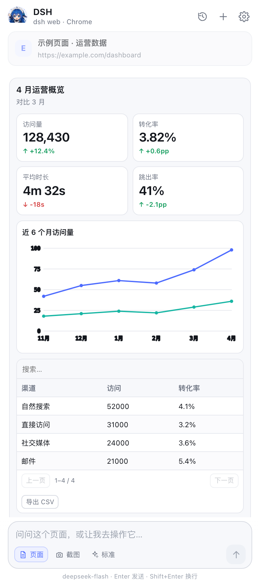
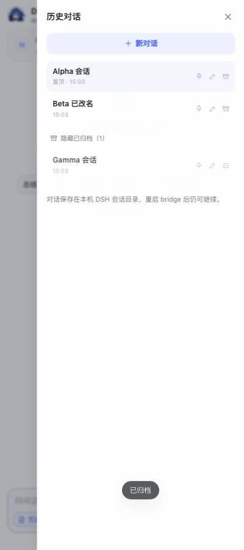

# DSH EasySider

> Chrome 超级侧边栏，基于 `dsh web`。

[English](README.en.md) · **简体中文**

把 DeepSeek Harness 装进 Chrome 侧边栏：读当前页、点按钮、填表单、截图，并用卡片/图表回答。复用 `dsh web` 的 `~/.dsh`——登录、模型、会话都是同一套。

<p align="center"><br><em>富 UI：KPI、折线图、可排序表格</em></p>

## 一句话交给 agent

把下面这句发给你正在用的 agent（Claude Code / Codex / DSH 等）：

> 帮我把 https://github.com/Uhao86/dsh-easysider 克隆下来并跑起来：先读仓库里的 `AGENTS.md`，按它执行到需要我手动加载 Chrome 扩展为止。

它会自己检查环境、登录 DSH、启动 bridge，到“该你装扩展了”时停下。Agent 的完整步骤在 [AGENTS.md](AGENTS.md)。

## 手动安装

需要 Node.js 22.19+。

```sh
git clone https://github.com/Uhao86/dsh-easysider.git
cd dsh-easysider
./start
```

`./start` 会自动检查 Node/DSH；缺 DSH 会问你要不要安装，没登录会打开一次 `dsh web` 登录页。看到 `pairing http://127.0.0.1:8787/` 后：

1. 打开 `chrome://extensions` → 开启**开发者模式** → **加载已解压的扩展程序** → 选 `extension/`。
2. 点工具栏的鲸娘图标（或 `Alt+Shift+S`）→ **自动获取 Token**。

Windows 用 Git Bash。更细的安装、配置、工具清单见 [operate.md](operate.md)；报错、限制、排错见 [warmtips.md](warmtips.md)。

## 可选：富 UI

推荐安装；不装也能用，只是回答退回 Markdown。

```sh
./start --with-ui
```

也可以先单独装插件，再正常启动：

```sh
DSH_HOME="$HOME/.dsh" dsh plugin --profile sdk add deepseek-harness-intelligent-ui
./start
```

## 它能做什么

- 读当前页：标题、正文、选中文字、可见区域截图、交互元素快照。
- 操作浏览器：点击、输入、滚动、查找、前进/后退、打开链接、等待。
- 多轮会话：历史支持置顶、重命名、归档；换标签页/重启 bridge 都能接着聊。
- 思考强度：快速 / 标准 / 深入 / 极限。
- 右键菜单；快捷键 `Alt+Shift+S`。
- 富 UI（可选）：卡片、KPI、表格、图表、时间线、Choice / Form。

<p align="center"><br><em>历史会话：置顶、重命名、归档</em></p>

## 隐私

bridge 只监听 `127.0.0.1`，每个 API 都要 token；页面正文、选中文字和你勾选附带的截图会发送给 DSH 配置的模型服务。详见 [operate.md 的隐私与权限](operate.md#隐私与权限)。

## 感谢相关仓库

- [DeepSeek Harness](https://github.com/deepseek-ai/deepseek-harness) — agent 运行时、SDK、MCP 客户端（MIT）。
- [deepseek-harness-intelligent-ui](https://github.com/dreamfarer-space/deepseek-harness-intelligent-ui) — 富 UI 组件与 `ui_render` / `ui_compose` / `ui_patch`（MIT）。
- [Sutera-Diffusus/dsh-whale-musume](https://github.com/Sutera-Diffusus/dsh-whale-musume) — 鲸娘素材（MIT © Sutera-Diffusus；插画 [@SuteraWu](https://github.com/SuteraWu)）。
- [Playwright](https://github.com/microsoft/playwright) — 浏览器测试，仅开发依赖（Apache-2.0）。

早期原型在 [deepseek-ai/dsh-superagent-prototype](https://github.com/deepseek-ai/dsh-superagent-prototype) 工作区开发；当前代码不依赖它。完整第三方许可见 [THIRD_PARTY_NOTICES.md](THIRD_PARTY_NOTICES.md)。

## License

MIT，见 [LICENSE](LICENSE)。本项目与 DeepSeek 官方无隶属关系。
