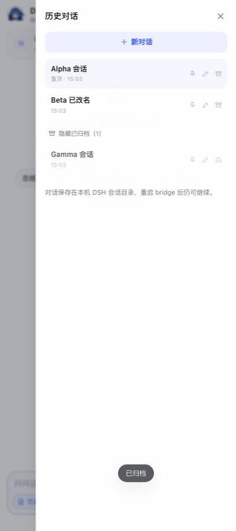

# 操作手册

[README](README.md) 只保留最短路径；完整安装、配置、工具和开发说明在这里。遇到报错、限制或排错，先看 [warmtips.md](warmtips.md)。

## 前置条件

- **Node.js ≥ 22.19**：DSH 运行时要求。
- **Chrome / Chromium ≥ 116**：Side Panel API。
- **Git**：拉取仓库。
- **一个 DeepSeek 账号**：第一次 `dsh web` 时登录。
- **可选：`deepseek-harness-intelligent-ui`**：富 UI 插件，推荐但不必需。

不需要单独检查 Chrome——这是 Chrome 扩展，能打开本仓库通常已经有 Chrome。macOS 仅在重新生成图标时需要 `sips`。

## 从零安装

### 1. Node.js

```sh
node -v
```

低于 22.19 或没有安装：

- macOS：`brew install node`，或 `nvm install 22 && nvm use 22`
- 其他平台：从 <https://nodejs.org/> 安装 Node 22
- 装完重开终端，再确认 `node -v`

### 2. 安装 DSH 并登录一次

```sh
npm install -g @deepseek-ai/dsh
dsh --version
DSH_HOME="$HOME/.dsh" dsh web
```

浏览器会打开 DSH Web。用 DeepSeek 账号登录、确认模型后，回终端按 `Ctrl-C`。这一步会生成 `~/.dsh` 和登录凭据。

- 端口冲突：`DSH_HOME="$HOME/.dsh" dsh web --port 3090`
- 不希望自动开浏览器：`DSH_HOME="$HOME/.dsh" dsh web --no-open`，手动打开打印的地址
- 显式带上 `DSH_HOME`，避免 shell 里已有的值把登录写到别的环境
- 已经登录过（`~/.dsh/.credentials.yaml` 存在）可以跳过
- `dsh: command not found`：重开终端，或把 npm 全局 bin 加入 `PATH`

### 3. 获取代码并启动

```sh
git clone https://github.com/Uhao86/dsh-easysider.git
cd dsh-easysider
./start
```

`./start` 会自动做这些事：

- 检查 Node ≥ 22.19
- 找 `dsh`；缺失时询问是否执行 `npm install -g @deepseek-ai/dsh`
- 没有 `~/.dsh/.credentials.yaml` 时打开一次 `dsh web` 登录页
- 没装富 UI 时只提示，不阻塞
- 启动本地 bridge

需要富 UI 就改用：

```sh
./start --with-ui
```

看到 `pairing http://127.0.0.1:8787/` 即启动成功。停止用 `./stop` 或 `Ctrl-C`。

### 4. 加载 Chrome 扩展

1. 打开 `chrome://extensions`，开启右上角 **开发者模式**。
2. 点 **加载已解压的扩展程序**，选择仓库里的 `extension/` 目录。
3. 把鲸娘图标固定到工具栏，点它（或按 `Alt+Shift+S`）。
4. 第一次点 **自动获取 Token**。

顶部页面卡片出现当前页标题即配对成功。加载失败看 [warmtips.md](warmtips.md#chrome-扩展加载失败)。

### 5. 第一次使用（Try it）

前提：bridge 在 `127.0.0.1:8787` 运行，扩展已加载并配对。

1. 打开 <https://example.com>（或任意普通网页）。
2. 点工具栏鲸娘图标，或按 `Alt+Shift+S`。
3. 第一次会看到“先连接本地 bridge”；点 **自动获取 Token**。
4. 输入 `总结这个页面，用三点`。
5. 试浏览器操作：`点击页面上的 “More information” 链接`。
6. 试富 UI：`用 ui_render 做一个包含 2 个 Stat、一个柱状图和一个表格的卡片`。
7. 试思考：把 **思考** 切到 `深入`，再问一个复杂点的问题。
8. 试历史：点右上角历史图标，置顶 / 重命名 / 归档。

没装富 UI 时，第 6 步会退化成 Markdown。

## 可选：富 UI

```sh
./start --with-ui
```

`--with-ui` 会在启动前把插件装进 `sdk` profile。也可以先单独装，再正常启动：

```sh
DSH_HOME="$HOME/.dsh" dsh plugin --profile sdk add deepseek-harness-intelligent-ui
./start
```

插件由 `dsh plugin` 直接安装，不需要克隆它的仓库。bridge 启动时会为它生成关闭 3D widget 的覆盖层。

不装也能用，只是模型的 `ui_render` / `ui_compose` / `ui_patch` 输出会退回 Markdown。当前在 `0.2.13` 上测试；升级后组件 schema 可能变化，改完先跑 `node test/render.mjs`。

## 配置

bridge 的参数可用命令行或环境变量，端口/token/模型写入 `.runtime/config.json` 后下次沿用（`DSH_HOME` 不持久化，每次按当前环境解析）：

```sh
./start --port 8787 --model deepseek-flash --dsh-home ~/.dsh
```

| 参数 | 环境变量 | 默认 |
|---|---|---|
| `--port` | `DSH_SIDEBAR_PORT` | `8787` |
| `--model` | `DSH_SIDEBAR_MODEL` | `deepseek-flash` |
| `--provider` | `DSH_SIDEBAR_PROVIDER` | `deepseek-official` |
| `--dsh-home` | `DSH_SIDEBAR_DSH_HOME` | `~/.dsh`（dsh web 的环境） |
| `--max-page-chars` | `DSH_SIDEBAR_MAX_PAGE_CHARS` | `8000` |
| `--reasoning-effort` | `DSH_SIDEBAR_EFFORT` | `auto`（省略；可 `off/low/high/max`） |
| runtime 目录 | `DSH_SIDEBAR_RUNTIME` | `.runtime` |
| `dsh` 路径 | `DSH_BIN` | 自动探测 |

> bridge **不读取** shell 里的 `DSH_HOME`：如果它为别的 harness 导出过，继承它会悄悄换回旧环境。要覆盖默认值用 `--dsh-home` 或 `DSH_SIDEBAR_DSH_HOME`。

> 注意：`DSH_HOME` 与 `dsh web` 共用时，侧边栏产生的会话（`sidebar-*`）也会出现在 `dsh web` 的会话目录里。如果不想混在一起，用 `--dsh-home` 指向单独的环境。

侧边栏设置里可改 Bridge 地址、token，以及两个开关：

- **页面**：是否附带正文（默认开，8k 字符预算）
- **截图**：是否附带当前可见区域截图（默认关）

输入框旁的 **思考** 下拉直接调 `POST /api/settings`：

```json
{ "reasoningEffort": "off" }
```

回合进行中会返回 409（避免中途杀掉运行时）；空闲时 bridge 会优雅关闭当前 DSH 进程，下一条消息按新强度重新初始化。

会话 ID 形如 `sidebar-<uuid>`，历史列表存在 `.runtime/sessions.json`，完整事件在 `DSH_HOME/sessions/`。UI 消息缓存在 `chrome.storage.local`。

### 换模型

```sh
./start --model <model-id>
```

模型必须能在 `deepseek-official` 路由上使用；其他 provider 可用 `--provider`。

## 工具清单

模型看到的是 `mcp__browser__browser_*`，界面上显示为中文动作。

| 工具 | 作用 |
|---|---|
| `browser_status` | 列出标签页，标出活动标签页 |
| `browser_read` | 标题、URL、选中文字、标题大纲、正文（默认 14k 字符，上限 60k） |
| `browser_snapshot` | 可交互元素 + 稳定 `ref`（`e1…`），跳转/刷新后需重新快照 |
| `browser_open` | 打开 URL（当前标签页或新标签页），等待加载 |
| `browser_click` | 按 `ref` / CSS selector / 可见文字点击 |
| `browser_type` | 输入，可清空、可提交表单 |
| `browser_scroll` | 上/下/顶/底，或把某个元素滚到视口 |
| `browser_find` | 页内查找文字，返回片段和可点击元素的 ref |
| `browser_screenshot` | 可见区域截图；`fullPage` 用 CDP 截长图 |
| `browser_history` | 后退 / 前进 / 刷新 |
| `browser_highlight` | 高亮 ref 或一段文字，不点击 |
| `browser_wait` | 等 selector / 文字出现，或固定等待 |

intelligent-ui 的宿主工具（不是 MCP，侧边栏直接渲染）：

| 工具 | 作用 |
|---|---|
| `ui_render` | 一棵声明式组件树：Card / Stack / Grid / Tabs / Stat / Table / Chart / Scatter / Heatmap / Timeline / Choice / Form … |
| `ui_compose` | 在一个回答里穿插 Markdown 与组件，适合“解释 + 图 + 结论” |
| `ui_patch` | 按 `uiId` 原位修改之前渲染的组件树（跨消息） |

Widget（`ui_render_widget`）默认不开放：MV3 扩展页的 CSP 会拦住任意内联/3D 脚本。需要时可在 profile 里打开 `enableWidget` 并自行补 iframe 运行时。

另有 DSH 自带的联网工具：`web_search`（搜索）和 `web_fetch`（抓取网页）。

## 历史会话

侧边栏的“历史对话”面板支持：

- **置顶**：固定在列表最上方；置顶优先于最近活动排序。
- **重命名**：行内编辑，Enter 保存、Esc 取消；自定义标题不会被首条消息覆盖。
- **归档 / 取消归档**：归档后从主列表折叠到“显示已归档”，可随时恢复。
- 点行切换会话；当前会话有高亮。

<p align="center"></p>

bridge 的会话索引在 `.runtime/sessions.json`，消息本体在 `DSH_HOME/sessions/`。相关 API：

```http
GET  /api/sessions                     # 全部会话（含 pinned/archived）
POST /api/sessions                     # { id?, title? } 创建空会话
POST /api/sessions/update              # { id, title?, pinned?, archived? }
```

清理开发/测试留下的一次性会话（**不会**动真实 `sidebar-<uuid>` 对话）：

```sh
node tools/clean-test-sessions.mjs          # 预览
node tools/clean-test-sessions.mjs --apply  # 删除 sidebar-probe-*/smoke-*/test-* 及测试专用 home
```

## 架构

```
┌──────────────────────── Chrome ────────────────────────┐
│  sidepanel.html/js          content.js                 │
│  · 聊天 UI / Markdown       · 读正文、元素快照          │
│  · SSE 接收 / 工具执行       · 点击、输入、高亮、等待     │
│         │  chrome.tabs / chrome.scripting              │
└─────────┼──────────────────────────────────────────────┘
          │  HTTP + SSE（127.0.0.1，token）
┌─────────▼──────────────────────────────────────────────┐
│  server/bridge.mjs        ：8787                        │
│  · 持有 DSH 子进程，转发事件                             │
│  · /api/chat  /api/stream  /api/tool-result  /api/pair  │
│  · 把 MCP 工具调用路由给侧边栏                            │
└─────────┬──────────────────────────────────────────────┘
          │  stdio JSON-RPC（newline framed）
┌─────────▼──────────────────────────────────────────────┐
│  DSH_HOME=~/.dsh                                       │
│  dsh --profile sdk --patch .runtime/sidebar.patch.yml   │
│  · 模型 / 会话 / 压缩 / 附件 / 与 dsh web 相同凭据        │
│  · 禁用了 bash、文件、子代理、workflow 等本地工具          │
│  · 挂载 MCP server：server/browser-mcp.mjs               │
│  · 挂载 intelligent-ui：ui_render / ui_compose / ui_patch │
└─────────┬──────────────────────────────────────────────┘
          │  MCP stdio（12 个 browser_* 工具）
┌─────────▼──────────────────────────────────────────────┐
│  server/browser-mcp.mjs                                 │
│  每个工具调用 POST 回 bridge /internal/tool → 侧边栏执行  │
└────────────────────────────────────────────────────────┘
```

### 为什么是 `sdk` 而不是 `web`

`dsh web` 的 profile 组合是 `@deepseek-ai/dsh-base` + `@deepseek-ai/dsh-web-app`，后者是一个 HTTP 应用（Web 服务器 + 浏览器前端），没有给外部客户端留聊天接口。bridge 需要一个能通过 stdio 长连接驱动的 agent，所以用 DSH 自带的 `sdk` 传输组合，但把 `DSH_HOME` 指向 `dsh web` 的环境。两者的 agent 底座（`dsh-base`、模型、工具、凭据、会话存储）是同一套；区别只在传输层。

工具集被刻意收窄为“浏览器 + 联网读取”：没有 shell、没有文件读写、没有子代理。因为页面内容是不可信输入，不能给它本地执行权。

## 与 dsh web profile 的关系

| 共享 | 不共享 |
|---|---|
| `DSH_HOME`（凭据、模型、会话目录） | `dsh web` 的 HTTP/Web GUI 进程 |
| DSH 版本、plugin 生态、`dsh-base` 工具 | Web 前端的 RPC 协议 |
| 同样的 `deepseek-flash` 模型 | — |
| 同一套 MCP 工具服务 | — |

如果你想让 **`dsh web` 自己的 GUI agent** 也能控制 Chrome，把下面的 overlay 合进
`~/.dsh/profiles/web/cordis.patch.yml`，重启 `dsh web`：

```yaml
- insert:
    - id: mcp-browser-sidebar
      name: '@deepseek-ai/dsh-mcp-client'
      config:
        serverName: browser
        transport: stdio
        command: node
        args:
          - /absolute/path/to/dsh-easysider/server/browser-mcp.mjs
        env:
          DSH_SIDEBAR_RUNTIME: /absolute/path/to/dsh-easysider/.runtime
        toolCallTimeoutMs: 90000
```

完整示例见 [`examples/web-profile-browser.patch.yml`](examples/web-profile-browser.patch.yml)。这样 `dsh web` 里的 agent 会多出 `mcp__browser__*` 工具；执行仍然发生在 Chrome 侧边栏里，所以侧边栏要开着。注意 bridge 必须先启动（`.runtime/config.json` 里是当前端口和 token）。

## 隐私与权限

**只在本机。** bridge 只绑定 `127.0.0.1`，每个 API 都需要随机 token；`/api/pair` 只接受扩展来源或本机页面。删除 `.runtime/config.json` 会轮换 token。

**会离开本机的内容。** 当前页正文、选中文字和你勾选附带的截图会随提示词发送给 DSH 配置的模型服务（默认 `deepseek-official`）。适用 DSH 自身的数据处理条款；本项目不额外增加遥测、分析或云端服务。

**本地数据。** token 存在 `.runtime/config.json`（0600）和 `chrome.storage.local`；会话在 `~/.dsh/sessions/`，UI 消息缓存在 `chrome.storage.local`。

**权限。**

| 权限 | 用途 |
|---|---|
| `sidePanel` | 侧边栏 UI |
| `tabs` | 读取标签页标题/URL、列出标签页、导航 |
| `scripting` + `<all_urls>` | 在你询问的页面上注入内容脚本 |
| `activeTab` | 用户触发时访问当前标签页 |
| `storage` | 设置与本地消息缓存 |
| `contextMenus` | 右键“总结本页 / 解释选中” |
| `debugger` | 通过 DevTools Protocol 截长图 |

如果只在少数站点使用，可以把 `<all_urls>` 收窄；`ensureInjected` 在其他站点会给出明确错误。

更完整的安全提醒见 [warmtips.md](warmtips.md#安全提醒)。

## 开发与测试

```sh
npm install                                # playwright-core，仅测试用
node --check server/bridge.mjs            # 语法
node tools/make-icons.mjs                 # 重新生成图标
node test/smoke.mjs                       # 不启动 Chrome：bridge + MCP + 模型一整轮
node test/ui.mjs                          # 真 Chrome：配对、读页、快照、点击、截图、ui_render、ui_patch
node test/render.mjs                      # 纯渲染：组件树 + compose，不调模型
node test/sessions.mjs                    # 会话 pin/rename/archive API
node test/sessions-ui.mjs                 # 历史面板的 pin/rename/archive（无模型）
node test/probe-live.mjs                  # 探测已在跑的 bridge（默认 8787，共享 ~/.dsh）
node tools/clean-test-sessions.mjs --apply  # 清掉本轮开发产生的一次性会话
```

`test/smoke.mjs` 用假扩展（SSE + 罐头工具结果）验证协议链路，会花一次很小的模型调用。
`test/ui.mjs` 需要 Chrome for Testing（品牌 Chrome 137+ 不再接受 `--load-extension`）。脚本会自动搜索
Playwright 的 Chromium 缓存（macOS/Linux/Windows），也可以用 `DSH_TEST_CHROME` 指定。这些测试都会创建
`.runtime-test` / `.runtime-ui` / `.runtime-render` / `.runtime-sessions-*` 里的隔离 `DSH_HOME`
（只软链 `~/.dsh/.credentials.yaml`），不会写你的正式会话目录。`test/ui.mjs` 会检查 `ui_render` 渲染成卡片、`ui_patch` 原位更新且不重复出卡片；它要求 `sdk` profile 已安装 intelligent-ui，否则跳过该测试；
`test/sessions-ui.mjs` 用真实面板验证置顶/重命名/归档。

### 目录

```
dsh-easysider/
├── server/
│   ├── bridge.mjs          # 本地 HTTP/SSE + DSH 子进程 + 工具路由
│   └── browser-mcp.mjs     # stdio MCP server，12 个 browser_* 工具
├── extension/
│   ├── manifest.json
│   ├── background.js       # 右键菜单 / 打开侧边栏
│   ├── sidepanel.html/css/js
│   ├── markdown.js         # 共享的 Markdown 渲染
│   ├── ui-render.js        # intelligent-ui 组件树的原生渲染器
│   ├── content.js          # 正文、快照、点击、输入、高亮、等待
│   └── icons/              # 鲸娘图标（tools/whale-girl-icon.html 渲染）
├── examples/
│   └── web-profile-browser.patch.yml
├── test/
│   ├── smoke.mjs
│   ├── ui.mjs
│   ├── render.mjs
│   ├── sessions.mjs
│   ├── sessions-ui.mjs
│   └── dsh-home.mjs
├── tools/
│   ├── whale-girl-icon.html   # 拟人形态（默认）
│   ├── whale-girl.webp        # 鲸娘素材（MIT，见 ICON-CREDITS.md）
│   ├── whale-icon.html        # 动物形态（回退）
│   ├── ICON-CREDITS.md
│   ├── clean-test-sessions.mjs
│   └── make-icons.mjs
├── start / stop
└── .runtime/               # 生成物：patch、token、会话标题、pid（gitignore）
```

### 改工具

1. 在 `server/browser-mcp.mjs` 的 `TOOLS` 里加 schema（名字 `browser_xxx`）。
2. 在 `extension/sidepanel.js` 的 `executeTool` 里加分支。
3. 如果需要在页面里做事，在 `extension/content.js` 的 `handlers` 里加操作。
4. 重启 bridge（`./start` 会重写 patch），侧边栏刷新即可。

### 改 UI 组件

- 组件的真实契约在 `deepseek-harness-intelligent-ui` 的 `src/catalog/catalog.js`。
- 渲染实现集中在 `extension/ui-render.js` 的 `renderCatalog` 的 `switch (node.type)`。
- 未知类型会降级成“暂不支持 + props 预览”，不会让整条消息渲染失败。
- 改完图标：`node tools/make-icons.mjs`（默认用 `tools/whale-girl-icon.html`；源图缺失或超过 1.5 MB 时自动回退到 `tools/whale-icon.html`）。

## 图标与素材

默认使用 **DeepSeek 鲸娘（拟人形态）** 的圆形头像：

- 素材来自 [Sutera-Diffusus/dsh-whale-musume](https://github.com/Sutera-Diffusus/dsh-whale-musume)（MIT © Sutera-Diffusus；插画 [@SuteraWu](https://github.com/SuteraWu)），经由 `deepseek-harness-intelligent-ui` 的 demo 素材取得。
- 完整署名和 MIT 文本见 [`tools/ICON-CREDITS.md`](tools/ICON-CREDITS.md)。
- 源图 53 KB；渲染出的 128px 图标约 32 KB，远低于扩展的体积限制。
- 如果源图缺失或超过 1.5 MB，`make-icons.mjs` 会自动回退到原创的**蓝色鲸鱼（动物形态）**。
- 这是同人网络形象，不是 DeepSeek 官方素材，也不代表官方认可。
